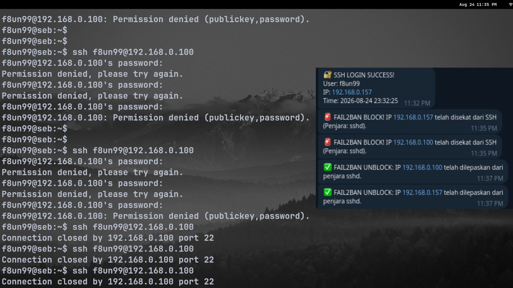

# Seb Centralized Services

## 1. CyberPower UPS Telegram Monitor
	

	 
A lightweight bash script and systemd service to monitor CyberPower UPS status via pwrstat on Linux (Debian) and send real-time alerts to a Telegram bot (Power failure, 50% battery warning, and 20% critical shutdown alert). I built this to solve a recurring issue at home: power trips during thunderstorms. Sudden, unexpected power loss can cause severe long-term damage to server hardware and data integrity. This project ensures I am instantly notified when the power goes out, allowing the server to be monitored and safely shut down before the UPS battery dies.

 **Automated Telegram Alerts:**
  * **Power Outage:** Immediate notification when the server switches to UPS battery power.
  * **Battery at 50%:** Warning when battery capacity drops to half.
  * **Critical Battery (20%):** Emergency alert before the server shuts down.
  * **Power Restored:** Notification when utility power is back and charging.

---

## 2. Fail2Ban & SSH Telegram Sentinel




A lightweight security monitoring setup for linux (Debian) that sends real-time Telegram alerts for successful SSH logins and automated Fail2Ban IP blocks.


* Scans all active jails (e.g., `sshd`) to retrieve blocked IP addresses.
* Clean, vertical numbered list display of banned IPs in Telegram.
* Automatically reports a **"Clean"** status if no IPs are currently blocked.

### External IP Ban

Kalau service duduk belakang Cloudflare Tunnel, IP client sebenar datang dalam header `CF-Connecting-IP`. Tapi cloudflared connect ke server dari `127.0.0.1`, so iptables tak nampak IP luar dan tak boleh block. Penyelesaian: app simpan blocklist sendiri (balas `403`), dan fail2ban baca log app untuk tambah/buang IP dalam blocklist tu.

Pastikan app tulis log macam ni bila login fail atau kena rate limit:

```text
2026-01-01 12:00:00 LOGIN-FAIL ip=203.0.113.10 user=admin
2026-01-01 12:00:01 RATE-LIMIT ip=203.0.113.10
```

1. Buat filter

```bash
sudo vim /etc/fail2ban/filter.d/weblogin.conf
```

```ini
[Definition]
datepattern = %%Y-%%m-%%d %%H:%%M:%%S
failregex = (LOGIN-FAIL|RATE-LIMIT) ip=<HOST>
ignoreregex =
```

2. Buat jail

```bash
sudo vim /etc/fail2ban/jail.d/weblogin.local
```

```ini
[weblogin]
enabled  = true
filter   = weblogin
logpath  = /var/log/weblogin.log
maxretry = 10
findtime = 600
bantime  = 3600
bantime.increment = true
bantime.factor    = 2
bantime.maxtime   = 604800
action   = weblogin-app
```

3. Buat action

```bash
sudo vim /etc/fail2ban/action.d/weblogin-app.conf
```

```ini
[Definition]
actionstart =
actionstop =
actioncheck =
actionban = /usr/local/sbin/weblogin-block.sh add <ip> ; /usr/local/sbin/weblogin-notify.sh "fail2ban BAN ip <ip>"
actionunban = /usr/local/sbin/weblogin-block.sh del <ip> ; /usr/local/sbin/weblogin-notify.sh "fail2ban UNBAN ip <ip>"
```

4. Test dan restart

```bash
sudo fail2ban-client -t
sudo systemctl restart fail2ban
```

5. Check IP yang kena ban

```bash
sudo fail2ban-client status weblogin
```

6. Unblock IP (optional)

```bash
sudo fail2ban-client set weblogin unbanip <IP_ADDRESS>
```

7. Block IP manually (optional)

```bash
sudo fail2ban-client set weblogin banip <IP_ADDRESS>
```

8. Check blocklist yang app guna

```bash
sudo cat /etc/weblogin/blocklist.txt
```

Note: IP dalam blocklist tetap dapat `403` walaupun iptables tak block, sebab trafik tunnel datang dari `127.0.0.1`.

---

### Prerequisites

1. **Telegram Bot Setup:** * Create a bot using [@BotFather](https://t.me/BotFather) and copy your **API Token**. * Get your Telegram User ID using [@userinfobot](https://t.me/userinfobot).
2. **UPS Software:** Ensure pwrstat (CyberPower PowerPanel Personal) is installed and properly monitoring your UPS. [https://www.cyberpowersystems.com/product/software/power-panel-personal/powerpanel-personal-linux/](https://www.cyberpowersystems.com/product/software/power-panel-personal/powerpanel-personal-linux/)


---


### Installation

1. Buat fail

```bash
sudo vim /usr/local/bin/seb.sh
```

Code ada dalam Github repo. Replace Token & Chat ID.

2. Jadikan executable

```bash
sudo chmod +x /usr/local/bin/seb.sh
```

3. Jadikan systemd services

```bash
sudo vim /etc/systemd/system/seb.service 
```

Code ada dalam Github repo. 

4. sshrc untuk notify kalau login successful

```bash
sudo vim /etc/ssh/sshrc
```

Code ada dalam Github repo. 

5. Activekan service

```bash
sudo systemctl daemon-reload
sudo systemctl enable seb
sudo systemctl start seb
sudo systemctl status seb
```

5. Change settings untuk PC tak mati cepat (optional). 

By default PC akan mati dalam 60s untuk minimize damage. Change this settings kalau rasa nak panjangkan and since aku ada bot yang akan tunjuk notification status of ups.

```bash
sudo vim /etc/pwrstatd.conf
```

```bash
powerfail-delay = 3600
```

Command ni untuk bagitau server bila UPS dah tinggal n% server akan shutdown. Ambil 20% sebab nak samakan dengan code sebab dia akan notify 50 % and 20%.

```bash
lowbatt-active = yes
lowbatt-threshold = 20
```

7. Save and restart service

```bash
sudo systemctl restart pwrstatd
```
---


### Services

1. Fail2ban

```bash
sudo systemctl restart fail2ban
```

2. Seb (for all features)

```bash
sudo systemctl restart seb.service
```

3. prstatd (ups)

```bash
sudo systemctl restart pwrstatd
```
